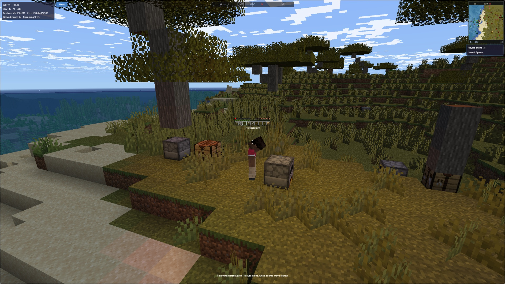

# AubsCraft

A Minecraft server admin panel and **live, GPU-driven 3D world viewer that runs in the browser**, built with **Blazor WebAssembly**, **SpawnDev.ILGPU** (WebGPU), and **ASP.NET Core**. Open a page and watch a running server: the real terrain, the players and creatures moving around on it, and their chat, with nothing to install on the viewer's machine.

Built by [Todd Tanner (@LostBeard)](https://github.com/LostBeard) for his daughter Aubriella's Minecraft server (mc.spawndev.com).

**Powered by the [SpawnDev](https://github.com/LostBeard) ecosystem:**
- [SpawnDev.VoxelEngine](https://github.com/LostBeard/SpawnDev.VoxelEngine) - GPU voxel meshing and rendering
- [SpawnDev.GameUI](https://github.com/LostBeard/SpawnDev.GameUI) - GPU-drawn game UI
- [SpawnDev.SpawnJS](https://github.com/LostBeard/SpawnDev.SpawnJS) - Full JS interop for .NET in the browser
- [SpawnDev.ILGPU](https://github.com/LostBeard/SpawnDev.ILGPU) - GPU compute on all 6 backends (WebGPU, WebGL, Wasm, CUDA, OpenCL, CPU)

---

## Live World Viewer



*Following a player on a live server, in the browser. Everything in the frame, including the stats, compass, minimap, player list, and the bars above the player's head, is drawn on the GPU. The HUD in this shot reads 60 FPS, 6,971 of 32,494 sections and 8.5M of 37.7M vertices in view, at a draw distance of 30 chunks.*

The viewer is a spectator client for a running Minecraft server, not a pre-rendered map. The panel reads the game's own world files and streams the raw block data to the browser, where it is meshed on the GPU. An optional server plugin adds what the files cannot show: creatures and players moving about, live block changes, editing, and voice.

**Written in .NET.** The application code is C# compiled to WebAssembly, and the frame loop runs on a Web Worker. The meshers are C# kernels that SpawnDev.ILGPU runs on WebGPU. The only plain JavaScript in the viewer's path is a small worker that receives the chunk stream. As of November 2026 we have not found another Minecraft world renderer built on .NET that runs in the browser: GitHub searches turn up .NET desktop and Unity renderers, and browser renderers in JavaScript, TypeScript, and Rust. If you know of one, we would like to see it.

### The world
- **The game's own assets** - textures, block models, tints, and animations are generated at build time from the Minecraft 1.21.5 client jar (about 1,200 tiles) and never committed to this repo
- **Real block shapes** - stairs, slabs, fences, doors, panes, torches, and the rest (428 shaped blocks)
- **Block entities** - chests, beds, shulker boxes, skulls, banners with their patterns, and signs with their text
- **Biome colors** - grass, foliage, and water tinted per pixel and blended across biome borders
- **Real light** - the world's own sky and block light, with soft ambient occlusion shading
- **Sky and weather** - sun, moon in its current phase, stars, drifting clouds, rain, and snow, on the server's clock
- **Effects** - animated water, lava, fire, and portals, smoke and flames from campfires, furnaces, and torches, transparent water, and an underwater look
- **Keeps up with the game** - the panel watches the region files and sends changed chunks to viewers. With the plugin, a changed block shows within 2 seconds. Without it, changes arrive when the game next saves

### Live activity
Needs the AubsCraft Live plugin on the server (see [Server side](#server-side)).

- **Creatures** - every living creature in 1.21.5 has a model, about 100 of them using the game's own geometry, all with walk cycles and head movement
- **Players** - their real skins, armor, and held items, with sneaking, riding, swimming, gliding, sleeping, swinging, eating, and drawing a bow
- **Player bars** - the hearts, hunger, armor, air, XP, and hotbar a player sees, shown above their head
- **Objects** - dropped items, boats, minecarts, armor stands, paintings, item frames, falling blocks, and arrows
- **Follow anyone** - click a name in the player list to go to them, follow them with an orbit camera, or see through their eyes
- **Chat and voice** - text chat from inside the viewer, plus proximity voice with players in the game through Simple Voice Chat, positioned in 3D

### The whole page is the viewer
There are no DOM controls over or around the canvas. The HUD (compass, heading-up minimap, player list, chat, notices, stats) and every setting are drawn on the GPU by SpawnDev.GameUI, including fullscreen, draw distance, field of view, lighting, voice, and switching servers. Settings are remembered per browser.

### Editing and admin
Owners and admins can change the live world from the viewer:
- **Build** - place and break blocks with a searchable palette of every placeable block, with undo and redo
- **Select** - box select, fill (solid or hollow), clear, copy, cut, and paste with turn and mirror
- **Blueprints** - save a selection under a name and place it again from a menu
- **Control** - player actions from the player list (bring here, game mode, heal, kick, ban) and a world panel (time, weather, save)

### VR and AR
Enter WebXR from the menu on a supported headset. VR has been run on a Quest 3, with fly controls, build tools, and small floating menus. In AR the world starts as a tabletop model that you can slide, turn, and zoom, or switch to life size.

### How it works

```
Region files --> ASP.NET Core panel --> binary WebSocket --> JS typed arrays --> GPU buffers
                                                                                     |
              screen <-- vertex-pulled draws <-- 8-byte packed quads <-- GPU greedy meshing
```

- **Chunk bytes never enter .NET** - they go from the socket to a GPU buffer (`CopyFromJS`), and .NET only orchestrates
- **All meshing is on the GPU** - `ColumnMesher` handles a whole 24-section column in a handful of dispatches, greedy merged and exact across column borders. No CPU fallback
- **Off the main thread** - the renderer owns an OffscreenCanvas in a dedicated worker, with live entities drawn in one instanced draw inside the world's pass
- **Few draws and binds** - one draw per column, with quads in shared 16 MiB buffers (about 45 buffer binds for 1,800 draws)
- **A far tier** - beyond the full-detail columns, 3 KB heightmaps are meshed on the GPU. Nothing is drawn or meshed past the fog
- **Adapts to the GPU** - the draw distance moves between 12 and 30 chunks with the frame rate and the fog follows it, so a weak GPU gets a closer horizon rather than a visible edge
- **Paced loading** - each mesh waits for a per-frame turn, nearest first, so the frame rate holds while the world streams in
- **AOT compiled client** - with IL kept so ILGPU can still compile kernels at run time

| Measured 2026-10-15, real world | Result |
|---|---|
| Development PC, 100 s after opening | about 240 fps, 7.3K columns and far chunks loaded |
| Intel UHD 620 laptop | settled at 52 fps with 625 draws, before the last frame-time fix |

*These predate the creature, lighting, and sky work and have not been re-measured since.*

The viewer is tested by about 90 Playwright tests (`AubsCraft.Viewer.Tests`) that drive the real viewer in Chrome, compare what it draws, and press every menu button with a real mouse.

### Controls

| Input | Action |
|---|---|
| Click, then mouse | Capture the mouse and look around |
| `W` `A` `S` `D`, `Space`, `Left Shift` | Fly, rise, descend |
| Wheel | Change flying speed (5-300 blocks/s), or zoom while following a player |
| `Tab` | Menu (all settings) |
| `F` | Fullscreen |
| `M` | Minimap zoom |
| `Enter` | Chat (when the mouse is not captured) |
| `F1` / `F3` | Hide the HUD / debug overlay |
| `Esc` | Release the mouse, close menus |

Owners and admins: `B` edit mode, `E` block palette, `V` select, `K` blueprints, `O` world panel, `1`-`9` block in hand, `Ctrl+Z` / `Ctrl+Y` undo and redo.

### Links

| Query | Effect |
|---|---|
| `/map?cam=x,y,z` or `cam=x,y,z,pitch,yaw` | Open at a place (the menu's Copy link makes these) |
| `time=ticks` | Hold the hour (0 sunrise, 6000 noon, 12000 sunset, 18000 midnight) |
| `dd=chunks` | Hold the draw distance |
| `light=0\|1`, `ao=0\|1` | Lighting and shading for this visit |
| `hud=0` | A clean frame with no HUD |

### Server side
The terrain needs only access to the world's region files. For live activity, install the **AubsCraft Live** plugin from the panel's Plugins page and restart the Minecraft server:

| Feature | Paper plugin | Fabric mod |
|---|---|---|
| Creatures, players, player bars | Yes | Yes |
| Instant block changes | Yes | No, changes arrive at the next save |
| Editing | Yes | No |
| Voice | Yes, with Simple Voice Chat | No |

### Current limits
- Overworld only, Nether and End are Phase O
- Viewers need a login to the panel
- The world streams on every visit, there is no offline cache yet (Phase D)
- The far tier draws shaped blocks as plain cubes
- No gamepad or touch controls on desktop and mobile yet (Phase D2)
- Voice has no push-to-talk or per-player mute yet
- VR hand tracking is built but untested on a real headset, and AR cannot yet anchor to a real surface

## Admin Panel

### Dashboard
- **Real-time player count and TPS** with live history graph via SignalR
- **Server status** - connected/disconnected, 1m/5m/15m TPS readings
- **Who's playing** - live player list with platform detection (Java, Bedrock, VR)

### Player Management
- **Whitelist** - add/remove with player avatars
- **Online players** - kick, ban, pardon with one click
- **Gamemode control** - switch between survival, creative, spectator, adventure
- **Teleport** - teleport any player to any other player
- **Player profiles** - play time, deaths, mob kills, blocks placed/broken, distance, advancements

### World Controls
- **Time/weather** - set time of day, weather, save world
- **Server broadcast** - send messages to all players
- **Activity log** - real-time timeline with filterable events
- **Live chat** - see and respond to in-game chat
- **Server console** - send any RCON command
- **Plugin manager** - view, enable/disable, install from Modrinth
- **Server control** - start, stop, restart via systemd

---

## Roadmap

See [PLANS.md](PLANS.md) for the full development plan.

### Completed
- [x] **Phase A** - Admin Panel (dashboard, players, world controls, console, plugins)
- [x] **Phase B** - 3D World Viewer Core (WebGPU, ILGPU kernels, heightmap, atlas)
- [x] **Phase C** - Viewer Polish (per-face textures, water transparency, plants, seabed, pointer lock)
- [x] **Phase E** - Visual features (time-of-day lighting, sky, weather, entities, biome tinting), delivered by Phase W
- [x] **Phase G** - Multi-user accounts with Owner, Admin, and Friend roles
- [x] **Phase V** - Viewer rebuilt on SpawnDev.VoxelEngine and SpawnDev.GameUI

### In Progress
- [ ] **Phase D** - Offline mode and a persistent render worker
- [ ] **Phase D2** - Gamepad, mobile touch, and streaming mode
- [ ] **Phase W** - World fidelity (assets, shapes, biomes, sky, and live creatures done; remaining animations, variants, and details)
- [ ] **Phase WE** - Editing, blueprints, admin control, and voice (working; brushes, thumbnails, `.schem` files, and push-to-talk remain). Replaces Phase L
- [ ] **Phase XU** - A UI made for VR and AR (working; hand controls and headset frame rate remain). Replaces Phase Q

### Planned
- [ ] **Phase F** - Map markers (spawn, deaths, beds, portals) and biome labels. Compass, coordinates, minimap, and deep links are done
- [ ] **Phase H** - MC account linking (AubsCraftLink plugin)
- [ ] **Phase I** - GriefPrevention claim visualization
- [ ] **Phase J** - Activity status, warp and last-logout markers. Live positions, skins, and following are done
- [ ] **Phase K** - Private messages and location sharing in chat. Text chat from the viewer is done
- [ ] **Phase M** - Public player profiles
- [ ] **Phase N** - AI villager NPCs (Claude-powered, voice chat)
- [ ] **Phase O** - Multi-dimension maps (Nether, End)
- [ ] **Phase P** - Drone cam and streaming. Following a player and seeing through their eyes are done
- [ ] **Phase R** - Inventory management from browser
- [ ] **Phase S** - Data analytics (CoreProtect integration, heatmaps)
- [ ] **Phase Z** - The North Star: browser-based Minecraft client

### Custom Server Plugins
| Plugin | Purpose | Status |
|--------|---------|--------|
| VRDetect | VR player detection | Done |
| AubsCraft Live (Paper) | Live entities and players, chunk changes, editing, voice bridge | Done |
| AubsCraft Live (Fabric) | Live entities and players | Done |
| AubsCraftLink | MC account to web account linking | Planned |
| AubsCraftClaims | GriefPrevention claim data API | Planned |
| AubsCraftChat | Web-to-game chat bridge | Planned |
| AubsCraftAI | AI villager NPCs | Planned |
| AubsCraftInventory | Web inventory management | Planned |

---

## Requirements

- [.NET 10.0 SDK](https://dotnet.microsoft.com/) (for building)
- Minecraft Paper or Spigot server with RCON enabled, and its world files readable by the panel
- WebGPU-capable browser (Chrome 113+, Edge 113+)

> **Building from source:** the client currently references pre-release `-local` builds of SpawnDev.SpawnJS, SpawnDev.VoxelEngine, and SpawnDev.GameUI from a local package feed, so a fresh clone will not restore until those versions are published.

## Quick Start

1. Clone the repository
2. Edit `AubsCraft.Admin.Server/appsettings.json` with your server details:
   ```json
   {
     "Rcon": {
       "Host": "127.0.0.1",
       "Port": 25575,
       "Password": "your_rcon_password"
     },
     "Minecraft": {
       "LogPath": "/opt/minecraft/server/logs/latest.log"
     }
   }
   ```
3. Run the server:
   ```bash
   dotnet run --project AubsCraft.Admin.Server
   ```
4. Open the URL shown in your browser
5. Create your admin account on first launch

## Project Structure

| Project | Description |
|---------|-------------|
| `AubsCraft.Admin` | Blazor WebAssembly frontend - UI pages and the viewer |
| `AubsCraft.Admin.Server` | ASP.NET Core host - RCON bridge, SignalR, binary WebSocket, world data |
| `AubsCraft.Viewer.Tests` | Playwright tests that drive the real viewer in Chrome |
| `AubsCraft.AssetTool`, `AubsCraft.Assets` | Generate the block, item, and creature assets from the Minecraft client jar |
| `AubsCraft.Live.Model` | Live frame format, smooth positions, creature models and animation |
| `LivePlugin` | AubsCraft Live for Paper (Java) |
| `LiveFabric` | AubsCraft Live for Fabric (Java) |
| `SpawnDev.Rcon` | Standalone Source RCON protocol client library (TCP, async, reusable) |
| `VRDetect` | Paper plugin (Java) - detects Vivecraft VR players |
| `Research/` | Design documents covering planned features |

## Tech Stack

- **Frontend** - Blazor WebAssembly (.NET 10), Bootstrap 5, SignalR, WebGPU, WebXR
- **GPU Compute** - SpawnDev.ILGPU (WebGPU backend) for all mesh generation
- **Rendering** - SpawnDev.VoxelEngine: vertex-pulled packed quads, reversed-Z, opaque + plant + alpha-blended water passes
- **HUD** - SpawnDev.GameUI, drawn on the GPU in the render worker
- **JS Interop** - SpawnDev.SpawnJS for WebSocket, OPFS, WebXR
- **Backend** - ASP.NET Core (.NET 10), SignalR hub, binary WebSocket, Source RCON
- **Client storage** - OPFS holds the camera position per server, localStorage the viewer settings
- **Worker** - Dedicated Web Worker with OffscreenCanvas for render isolation, plus a small data worker for the chunk stream
- **Deployment** - Self-contained linux-x64, systemd service, SSH + mapped drive deploy

## Cross-Platform Support

Players and viewers detected by platform:
- **Java** - standard Minecraft Java Edition
- **Bedrock** - players connecting via GeyserMC (Floodgate prefix)
- **VR** - Vivecraft players (VRDetect plugin)
- **Web Viewer** - browser-based spectators (planned: visible in-game as drones/birds)

## License

MIT - see [LICENSE](LICENSE)
